


  

 

### `> whoami`

I'm a **final-year Network & Information Security engineering student** working where **security engineering meets education**.
I take the hardest modules of my curriculum — cloud security, digital forensics, ISO 27001 — and rebuild them as **free, interactive exam-preparation platforms**: clear courses, visual diagrams, a quiz after every chapter, timed mock exams and fully corrected answers.

> *A good explanation beats a hundred slides. If one of my platforms saved you hours before an exam, it did its job.*

### `> ls ./platforms`

<a href="https://nse4-fortigate.vercel.app"></a>

<a href="https://cpa-english.vercel.app"></a>
<a href="https://cpf-francais.vercel.app"></a>

### `> ls ./more-study-tools`

<a href="https://revisionappiam.vercel.app"></a>
<a href="https://quizcyberops.vercel.app"></a>
<a href="https://quizccnayassine.vercel.app"></a>
<a href="https://spring-flax.vercel.app"></a>
<a href="https://dotnet-zeta-ten.vercel.app"></a>
<a href="https://tie-seven.vercel.app"></a>
<a href="https://droit-virid.vercel.app"></a>
<a href="https://anglaisrevision.vercel.app"></a>
<a href="https://quizgprojet.vercel.app"></a>

`clear course` · `visual diagrams` · `quiz after each chapter` · `timed mock exams` · `corrected answers` · `mobile-ready` · `free`

### `> ls ./projects --security`

<a href="https://banking-cti.vercel.app"></a>
<a href="https://github.com/EssidYassine/PersoDash/releases/latest"></a>
<a href="https://github.com/EssidYassine/BingoTrap"></a>
<a href="https://forum-qr.vercel.app"></a>

### `> ls ./projects --engineering`

<a href="https://github.com/EssidYassine/EventPlanner-Symfony"></a>
<a href="https://github.com/EssidYassine/EventPlanner-C-QT"></a>
<a href="https://github.com/EssidYassine/School-Management-MEAN"></a>
<a href="https://maison-de-cafe.vercel.app"></a>

🔒 <b>PRIVATE</b> = source available on request · 🟢 <b>LIVE</b> = online demo · 🟡 <b>OPEN SOURCE</b> = public repository

### `> cat skills.txt`


### `> contact --help`

| | |
|---|---|
| ⭐ **Star a repository** | if it helped you — it helps other students find it |
| 🐛 **Open an issue** | if you spot a mistake — corrections go live fast |
| 🤝 **Get in touch** | if you want a platform for your module or a collaboration |

 
<i>Built by a student, for students.</i> 🎓

